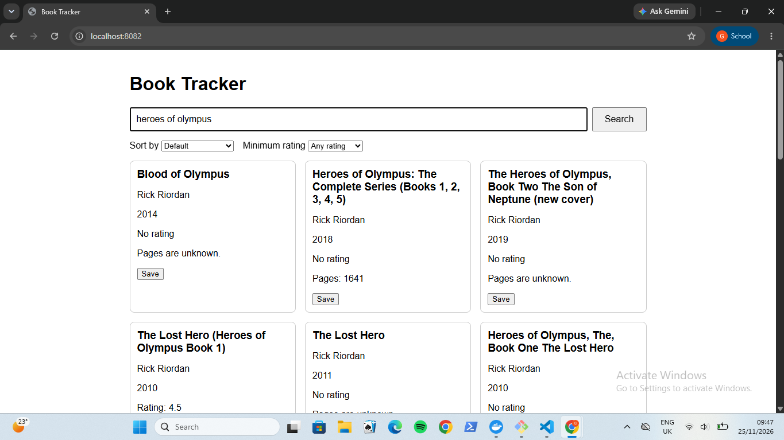
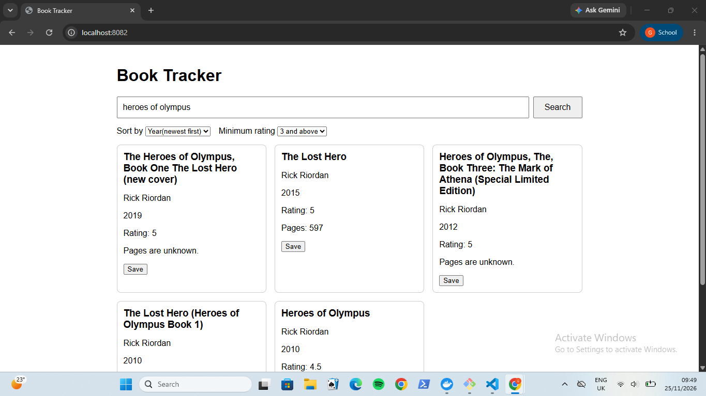
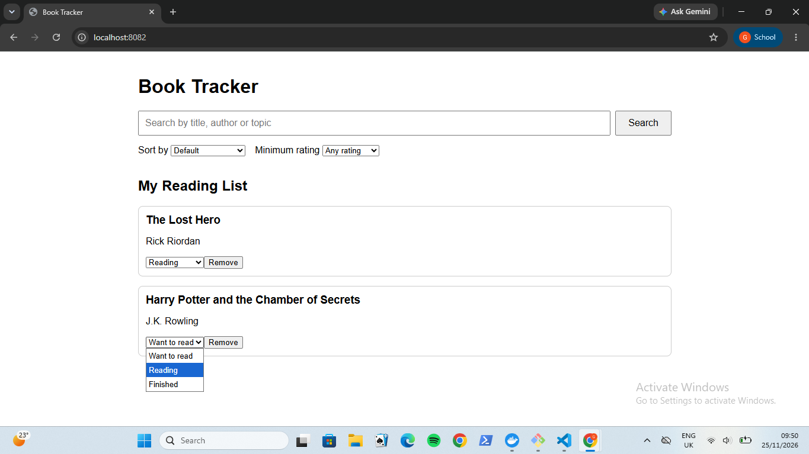
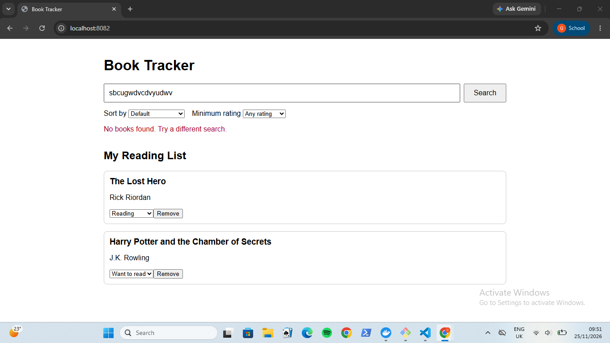
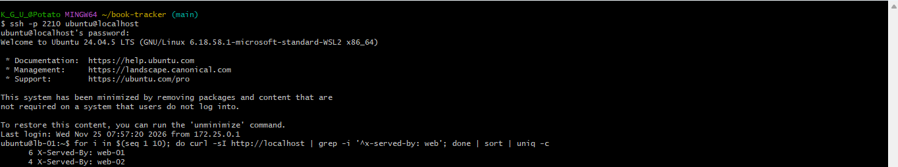
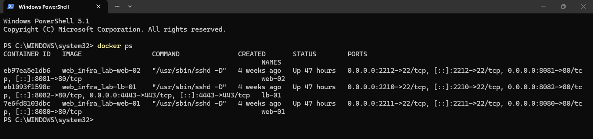

# book-tracker

# Purpose
Book Tracker helps people who love reading learn more about abook before they choose it: its rating, the year it was published and how many pages it has, so they can decide whether to read it. They can also save books to a reading list and mark each one as Want to read, Reading or Finished, which helps them stay on track with their reading.

# Links
- Demo video: https://www.veed.io/view/ff2f09d7-c6d7-4d07-8393-e62a8bb85e61?source=editor&panel=share
- Deployed app: http://localhost:8082
- Repository: https://github.com/k-gloire/book-tracker

# Features
- Search books by title, author or topic (Google Books API)
- Sort results by title (A-Z) or by year (newest first)
- Filter by minimum rating
- Each card shows author, year, rating and page count, with fallbacks when data is missing ("No rating","Pages are unknown")
- Reading list: save books and set their status(Want to read, Reading, Finished). It is stored in the browser ('LocalStorage'), so the servers keep no user data.
- Error handling: empty search, no results, no books matching the filters, and API or network failures all show a clear message.

## API Used and Credits
- Google Books API: https://developers.google.com/books/docs/v1/using.
- Libraries and tools: Express, dotenv (Node.js), Nginx, Docker, Ubuntu 24.04.

## Run Locally
1. Clone the repository: git clone https://github.com/k-gloire/book-tracker, then cd book-tracker
2. Install the dependencies listed in package.json: npm install
3. Copy .env.example to .env and put your Google Books API key in it: GOOGLE_BOOKS_KEY=place_your_key_here
4. Start the app: npm start
5. Open http://localhost:3000

## Security
The API key is read from .env on the server (process.env.GOOGLE_BOOKS_KEY). .env is listed in .gitignore, so it is never uploaded to GitHub. The browser calls my own '/api/search' route, and the server adds the key when it calls Google, so the key never reaches the browser.

## Deployment
The lab runs three Docker containers (Ubuntu 24.04): web-01, web-02 and lb-01. Each is reachable over SSH from my laptop on a different port (2210 for lb-01, 2211 for web-01, 2212 for web-02).

On **web-01** and **web-02** I did the following:
1. Installed Node.js, npm, git and Nginx: sudo apt-get install -y --no-install-recommends nodejs npm git ca-certificates nginx
2. Cloned the repository, ran npm install, and created .env with the API key (The file is not in GitHub).
3. Started the app in the background: nohup npm start > app.log 2>&1 & (it listens on port 3000).
4. Configured Nginx as a reverse proxy: it listens on port 80 and forwards to the app on port 3000, and adds a header 'X-Served-By' with the server name so I can prove which server answered (see screenshots/nginx-web-config.png).

**Restarting after a shutdown:** Docker containers keep their files, but the app and Nginx stop. On each web server run sudo service nginx start, then cd ~/book-tracker, then nohup npm start > app.log 2>&1 &.

## Load Balancer
lb-01 runs Nginx with an 'upstream' block listing web-01 (172.25.0.11) and web-02 (172.25.0.12), and forwards each request to the next server in turn (round robin) . See screenshots/nginx-lb-config.png.

**Testing:** I sent 10 requests to the load balancer and counted the 'X-Served-By' header in the replies: 5 from web-01 and 5 from web-02 (screenshots/load-balancer-count.png). The app works through http://localhost:8082 (screenshots/app-via-load-balncer.png).

## Screenshots

## Challenges and Solutions
1. Typos. For example ariaValueMax instead of value, ratingselct instead of ratingSelect, getElementedById, and push9. They stopped the whole page working, and VS code showed errors. I fixed by Ctrl+F on the wrong name.
2. The .env variable name is case-sensitive. Google_books_key in the code didn't match GOOGLE_BOOKS_KEY in .env, so the key came out empty and Google rejected the requests.
3. The reading list didn't update. The loop that draws the list was outside its function, so it ran once at page load. I fixed by moving it inside and matching the braces.
4. Installing Node on the server failed with "404 Not Found" errors. You fixed it with apt-get update and --no-install-recommends.
5. Docker wouldn't start on a 4GB laptop (WSL, timeout errors). I fixed it by freeing memory, limiting WSL's memory, restarting WSL, and opening worked on retry.

##                    
Author
Keza Gloire